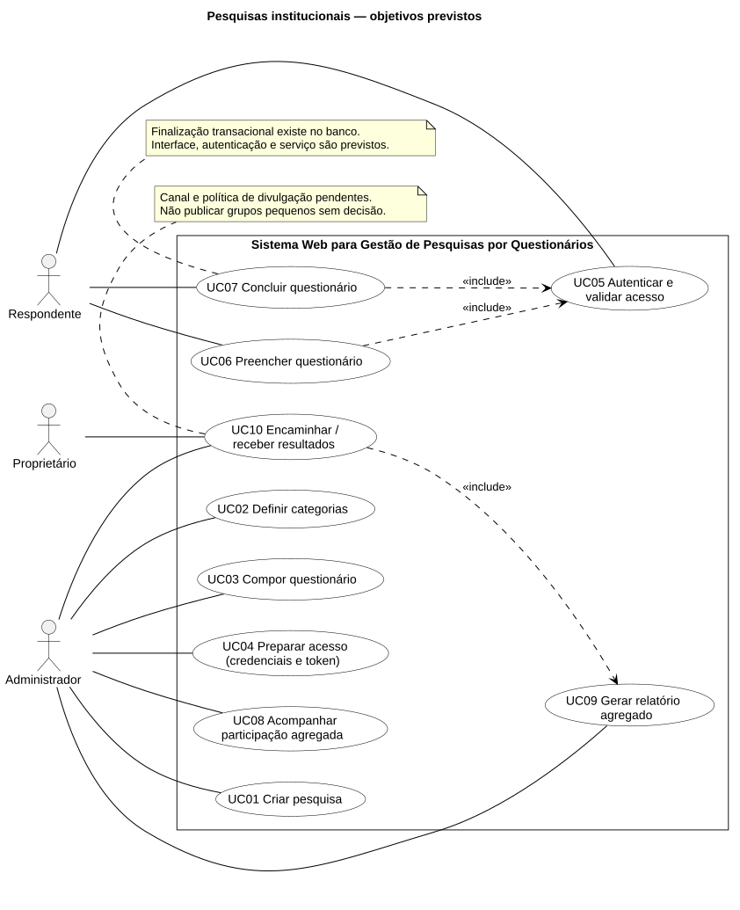
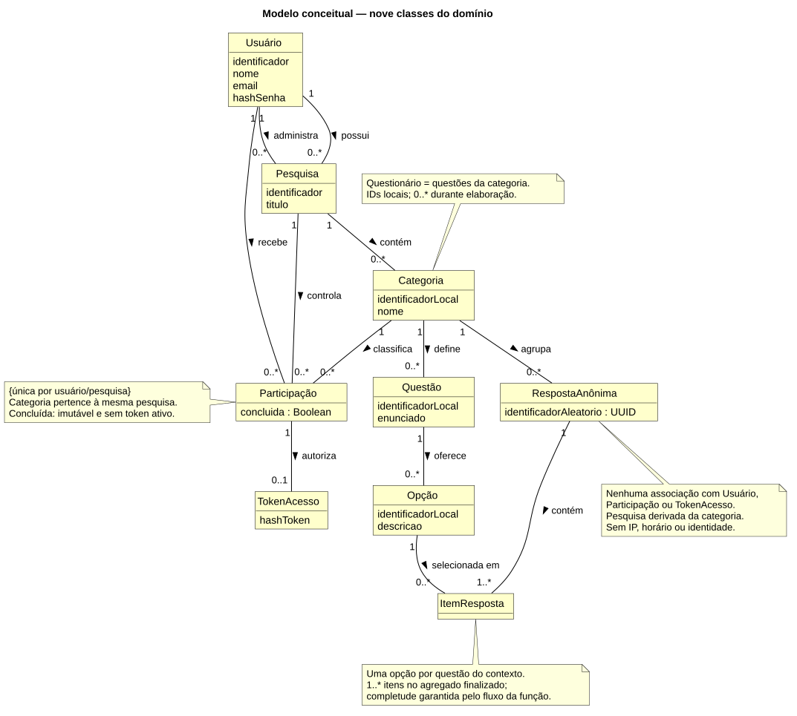
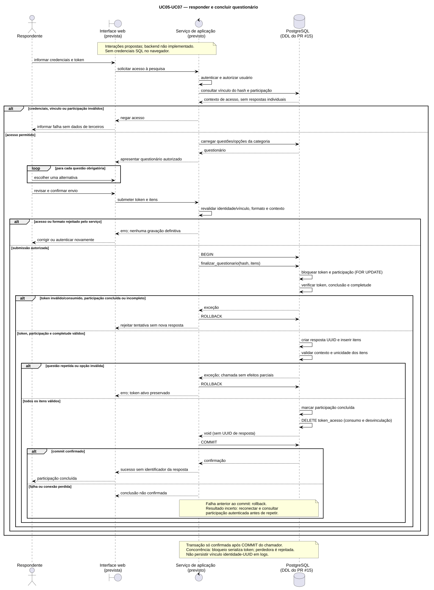
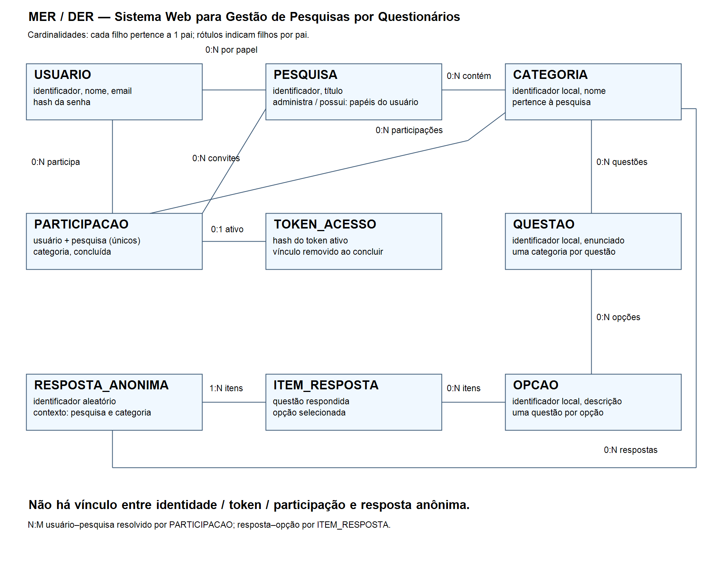

# Sistema Web para Gestão de Pesquisas por Questionários

Projeto Integrador II — ADS — FATEC Lins — 2026-2. Material de apresentação em Markdown, atualizado em 23/10/2026.

## 1. Problema e objetivo

Organizar pesquisas institucionais, seus questionários, participantes e resultados. O projeto reúne análise de requisitos, modelagem de dados e prototipação de interfaces. A entrega acadêmica demonstra esses artefatos; não representa um serviço de coleta em produção.

## 2. Escopo entregue

- Engenharia de Software: requisitos, critérios de aceitação, regras e três diagramas UML.
- Banco de Dados: MER/DER, modelo lógico, DDL, carga fictícia, consultas e evidências de testes.
- Desenvolvimento Web: 12 páginas HTML, CSS mobile-first, interatividade JavaScript, wireframes e publicação.
- Compliance e Segurança: relatórios específicos ainda pendentes nas issues #11 e #12.

## 3. Atores e requisitos

Administrador prepara pesquisas e acompanha agregados; respondente preenche questionários; proprietário recebe resultados autorizados. Os papéis são contextuais, sem presumir um catálogo global de permissões implementado.

O levantamento registra 10 requisitos funcionais e 9 não funcionais, com regras, origem e aceitação futura. [Conteúdo completo](../engenharia-software/requisitos.md).

## 4. Casos de uso

Os dez casos de uso cobrem cadastro, acesso, preenchimento, conclusão e resultados. São especificações de comportamento, sem comprovar backend implementado.

## 5. Classes e sequência

O modelo distingue participação nominal de resposta anônima. A sequência descreve validação, preenchimento, revisão, transação e tratamento de falhas. [Especificação e fontes editáveis](../engenharia-software/modelagem-uml/README.md).

## 6. Banco de dados

Nove entidades, relações e cardinalidades documentadas; modelo lógico justificado até 3FN. O DDL contém chaves, restrições, funções e gatilhos. [Modelo lógico](../banco-de-dados/modelo-logico.md) · [DDL](../banco-de-dados/schema.sql).

## 7. Integridade e relatórios

A finalização registra resposta/itens, conclui participação e consome o token na mesma transação. A carga é fictícia; quatro consultas usam JOIN, COUNT e GROUP BY para pesquisa, categoria e alternativa, incluindo zero votos.

As evidências anteriores em PostgreSQL 18.6 registram integridade, rollback, token consumido, correções de gatilhos/search_path e concorrência com um sucesso e uma rejeição. Não foram reexecutados os testes SQL nesta montagem documental. [Evidências completas](../banco-de-dados/testes/resultados.md).

## 8. Arquitetura das telas

[Sitemap e quatro wireframes](../desenvolvimento-web/wireframes/sitemap.md). A navegação conecta início, login, painel e nove funções. HTML semântico, rótulos, alt, foco visível e CSS mobile-first foram implementados.

## 9. Demonstração prática

1. Abra [o protótipo publicado](https://fatec-extensao.github.io/pi-ads-2026-1-schiazza/) e percorra início e painel.
2. Abra Responder questionário e use o código fictício DEMO-2026.
3. Tente avançar sem preencher uma pergunta obrigatória.
4. Preencha, avance e volte para conferir a preservação temporária da escolha.
5. Conclua a simulação e confira a mensagem final.
6. Abra relatórios e altere a categoria para demonstrar os agregados fictícios.

Não use dados pessoais reais. O login apenas valida formatos e abre a demonstração; não implementa autenticação. Os formulários não enviam nem persistem dados. O banco não está conectado ao front-end.

## 10. Validação e reprodução

Validador UML e verificação estrutural Web disponíveis no repositório. A suíte de navegador verifica páginas em 360 e 1280 px, campos inválidos/válidos, datas, alternativas, navegação, conclusão, filtros e ausência de erros JavaScript/HTTP. Resultados locais e públicos devem ser consultados nas [evidências Web](../desenvolvimento-web/testes/README.md).

## 11. Pendências exclusivamente registradas em Segurança

Issue #11: relatório próprio de riscos, matriz de probabilidade/impacto e mitigações. Issue #12: documento de privacidade/anonimato, decisões de retenção e exclusão e aviso/TCLE quando aplicável. Os limites técnicos já documentados não substituem essas entregas.

Não há afirmação de anonimato absoluto, conformidade jurídica, certificação de acessibilidade ou produto pronto para produção. Aprovação acadêmica depende do professor.

## 12. Entrega e acesso ao conteúdo

[Índice de todos os artefatos](./conteudo-das-issues.md) · [Registro de revisão](./README.md). O pacote inclui fontes, diagramas, SQL, front-end e testes; os relatórios de Segurança permanecem claramente identificados como pendentes. Esta apresentação em Markdown é o material disponibilizado para a entrega; não foi gravado vídeo nesta etapa.
